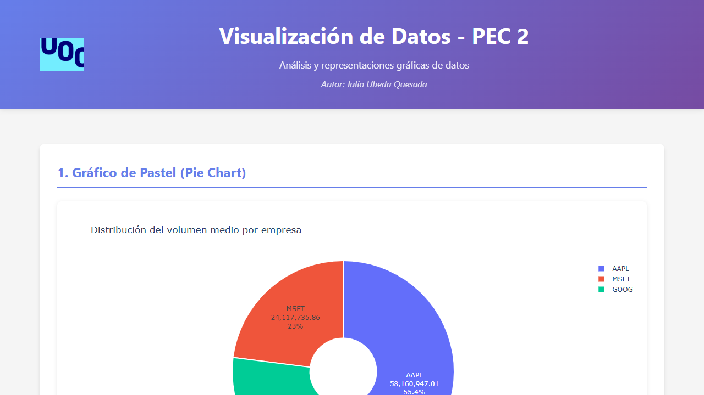

<div align="center">


# Técnicas de visualización de datos financieros

Tres técnicas de visualización aplicadas a cotizaciones de Apple, Microsoft y Google, publicadas como página web interactiva.

[](https://juliouq.github.io/Tecnicas_de_Visualizacion_de_Datos/)

   



</div>

---

## Descripción general

Ilustra tres enfoques distintos sobre los mismos datos bursátiles (AAPL, MSFT y GOOG): proporciones, evolución temporal y dispersión geométrica.

## Funcionalidades

- **Gráfico de sectores:** volumen medio negociado por empresa.
- **Velas japonesas:** evolución de los precios de apertura, máximo, mínimo y cierre, con tendencias y volatilidad.
- **Envolvente convexa:** polígono mínimo que contiene los puntos de cada empresa, para comparar dispersión y estabilidad.

## Tecnologías y herramientas

| Ámbito | Herramientas |
| --- | --- |
| Gráficos | Plotly, Plotly Graph Objects |
| Geometría | SciPy (`ConvexHull`) |
| Datos | pandas |

## Estructura del proyecto

```text
.
├── index.html            # Página publicada en GitHub Pages
├── Visualizaciones.py    # Genera los tres gráficos
├── Visualizaciones/      # Gráficos exportados en HTML
├── notebooks/            # Desarrollo en Jupyter
├── Data/                 # acciones_limpio.csv
└── Presentacion/         # Diapositivas y vídeo
```

## Instalación y uso

```bash
pip install pandas plotly scipy
python Visualizaciones.py
```

## Autor

**Julio Úbeda Quesada** · Data Scientist

[](https://juliouq.github.io/Portfolio-Web---JulioUQ/es/) [](https://www.linkedin.com/in/juliouq/) [](https://github.com/JulioUQ)

<sub>Proyecto realizado en el Máster Universitario en Ciencia de Datos.</sub>
